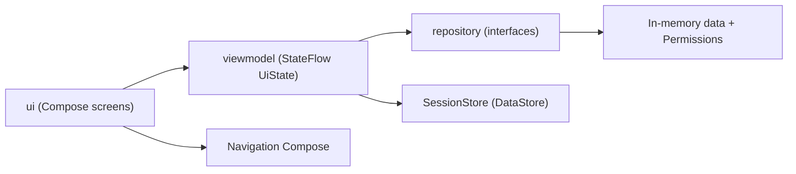
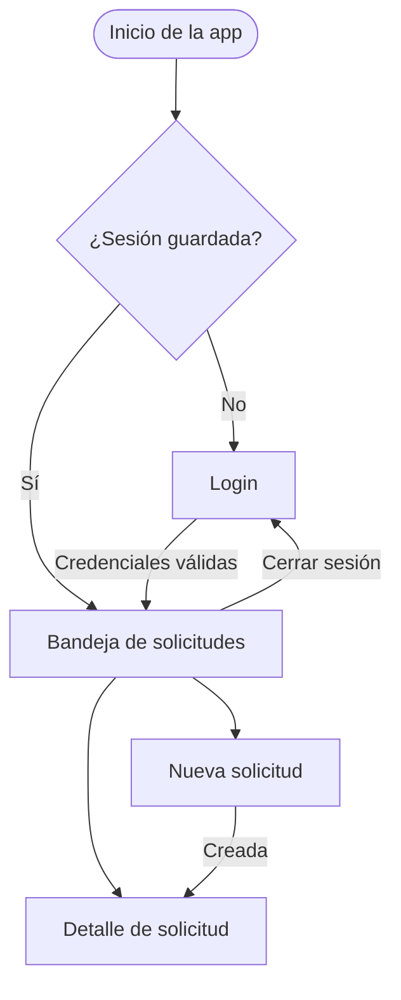
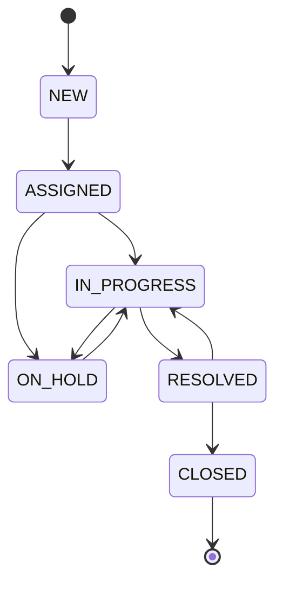

# PanalSuite Mobile

MVP académico Android (Kotlin + Jetpack Compose) del caso **DSY1105 · Panalbit**: gestión móvil de
solicitudes (tickets) y flujos de trabajo. Usa únicamente datos ficticios.

## Funcionalidades

- Login con validación y sesión persistente (DataStore).
- Control de acceso por roles: solicitante, resolutor, supervisor, gerencia y administrador.
- Bandeja de solicitudes con búsqueda, filtros por estado y panel resumen (supervisor/gerencia).
- Crear solicitud con formulario validado.
- Detalle: cambio de estado con nota obligatoria, asignación de responsable, comentarios e historial.
- Animaciones en navegación, lista y cambio de estado.

## Cuentas de prueba

Contraseña de todas: `Demo1234!`

| Rol | Correo |
|---|---|
| Solicitante | solicitante@panalbit.test, solicitante2@panalbit.test |
| Resolutor | resolutor@panalbit.test, resolutor2@panalbit.test |
| Supervisor | supervisor@panalbit.test |
| Gerencia | gerencia@panalbit.test |
| Administrador | admin@panalbit.test |

## Arquitectura



## Flujo de navegación



## Flujo de estados de una solicitud



## Estructura

```
com.example.evaluacion1
├── model        // entidades y enums del dominio
├── repository   // interfaces, datos en memoria, permisos y SessionStore
├── viewmodel    // un ViewModel con UiState por pantalla + validaciones
└── ui           // theme, components, login, tickets y navigation
```

## Convenciones

- Commits en inglés con Conventional Commits (`feat:`, `fix:`).
- Tests unitarios en `app/src/test` (validaciones y permisos).
